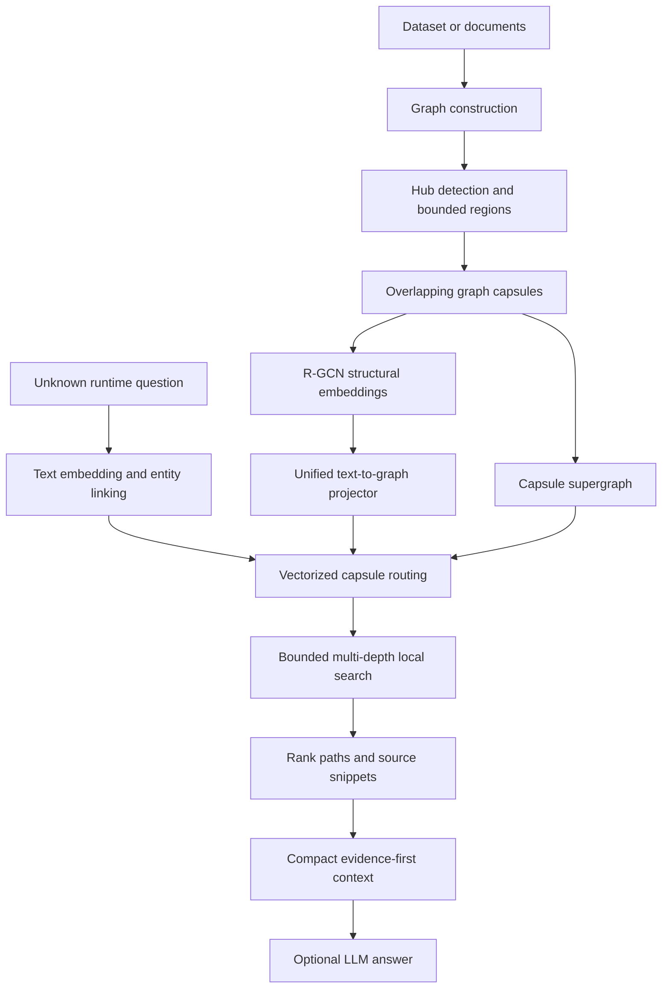

# 1. System Overview

## Why this system exists

A language model cannot safely read an entire large corpus or knowledge graph
for every question. A retriever must first choose a small amount of useful
evidence. Ordinary RAG finds text passages with similar wording. GraphRAG also
follows entities and relations, which is useful for questions such as:

> Which languages are used by films that share a director with *Film A*?

The answer is not necessarily written in one passage. It may require:

```text
Film A -> director -> another film -> language
```

The optimized system aims to retain that reasoning ability without searching
the complete graph for every query.

## Layman’s analogy

Imagine a national library:

- **Documents/chunks** are pages.
- **Graph nodes** are people, films, places, topics, and pages.
- **Edges** are labelled facts such as `DIRECTED_BY` or `MENTIONS`.
- **Regions** are floors of the library.
- **Capsules** are carefully prepared research folders around important topics.
- **The capsule supergraph** is a map showing which folders overlap.
- **The query projector** is a librarian trained on many kinds of questions.
- **Path search** opens a few folders and traces exact labelled facts.

The librarian is not told “this question needs three steps.” It keeps useful
one-, two-, and three-step evidence, ranks it, and gives the best compact set to
the answering model.

## Complete lifecycle



## Offline work versus online work

Offline/index-time work can be relatively expensive because it is reused:

- construct the graph;
- partition it;
- build/validate capsules;
- train the R-GCN;
- train the unified query projector;
- cache embeddings.

Online/query-time work stays bounded:

- embed one question;
- link entities;
- route exact linked seeds through the capsule membership index;
- use learned vector routing only when exact linking cannot determine a launch capsule;
- search the original graph directly with a per-seed bounded beam;
- return at most 11 final paths plus ranked source snippets.

## Hop-agnostic behavior

“Hop” is a property of an annotated benchmark answer path, not normally known
when a user asks a question. This project therefore uses:

- one MetaQA graph and R-GCN;
- one projector trained on a shuffled 1/2/3-hop mixture;
- one runtime configuration with a maximum search depth of three;
- depth-balanced candidates and final evidence;
- three separate test slices only for analysis.

The maximum depth is still a compute safety ceiling. Supporting arbitrary
unbounded reasoning would require increasing it or adding an iterative stopping
policy; no finite retriever can search an unlimited graph.

The deployed corpus/index is still a system-level choice. A MetaQA projector is
not expected to understand an unrelated 2Wiki graph space because their capsule
IDs and relation vocabularies differ. Serving several independent corpora behind
one endpoint would add a corpus router or federated retrieval layer; that is
different from requiring the user to know a question’s reasoning depth.

## Safety invariants

The implementation treats these as correctness rules:

1. Every graph node belongs to at least one capsule.
2. Every linked query seed receives capsule and path-search opportunity.
3. Exact seed neighborhoods protect facts crossing capsule boundaries.
4. Artifact fingerprints must match runtime capsules.
5. Train questions and final test questions remain separate.
6. Boolean accuracy is not measured by finding the words “yes” or “no” in context.
