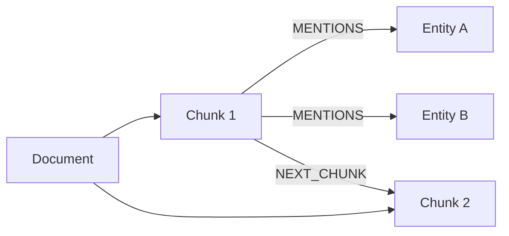
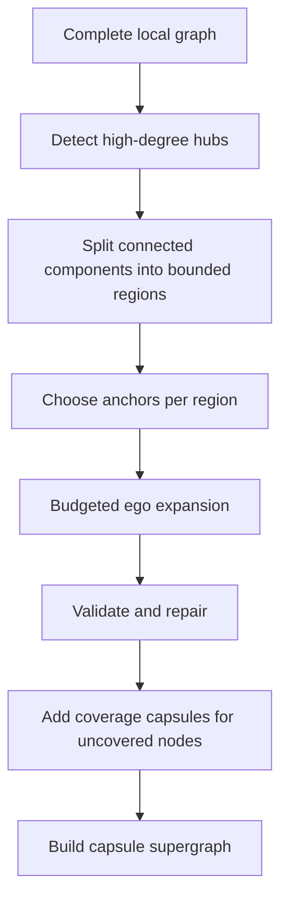

# 2. Graph Construction and Capsules

## Graph inputs

The system supports two graph sources.

### Native graph datasets

MetaQA already supplies triples:

```text
movie | directed_by | director
```

Each unique entity becomes a node and each triple becomes a typed edge. The full
134,741-triple KB is retained. Triple documents are not embedded for optimized
MetaQA indexing because that would duplicate the native graph and previously
caused invalid corpus slicing.

### Document datasets

Documents are chunked with overlap. An extractor creates entities and relations.
Chunk nodes store source text and provenance; `MENTIONS` edges connect chunks to
entities and `NEXT_CHUNK` preserves document order. If extraction produces too
few edges, a deterministic document-chain graph is used as a fallback.



## Why capsules are needed

Searching the whole graph for every query is unpredictable: hubs can explode
the frontier and irrelevant neighborhoods consume context. A capsule is a
bounded, connected, overlapping ego-graph with:

- an anchor node;
- a region ID;
- capped nodes and edges;
- typed relations;
- source IDs and a short summary;
- connectivity, density, hub, and overlap statistics.

Capsules are not clusters that partition the graph exactly once. Overlap is
intentional because boundary facts often connect topics.

## Construction algorithm



### 1. Hub detection

A node is a hub when its degree is at least:

```text
max(min_degree=3, 95th percentile of graph degree)
```

Hub expansion is capped because nodes such as “English” or a prolific actor can
connect to thousands of facts.

### 2. Region partitioning

Connected components larger than `max_region_nodes` are recursively split.
Six rounds of deterministic label propagation try to keep neighboring nodes
together. If one group still contains more than 85% of the parent, a balanced
degree-ordered split is used. This is a dependency-free approximation to the
goal of Leiden/METIS: high internal locality with bounded partition sizes.

### 3. Anchor selection

Non-hub nodes are preferred when possible. The score is:

```text
0.55 * degree
+ 0.25 * document-frequency proxy
+ 0.20 * external-neighbor count
```

Degree finds locally important entities, document frequency favors grounded
nodes, and external neighbors identify bridges.

### 4. Budgeted ego expansion

From each anchor, breadth-first expansion runs for at most two capsule-building
hops and stops at configured node/edge limits. Hub neighbors are additionally
capped. Boundary nodes are added using stable score and ID tie-breaking.

### 5. Validation and repair

The validator trims oversized capsules, removes dangling edges, keeps the
largest connected component when connectivity is poor, and reduces excessive
hub dominance. MetaQA defaults cap a capsule at 250 nodes and 900 edges.

### 6. Guaranteed coverage

After normal capsules are deduplicated, uncovered nodes receive deterministic
fallback ego capsules. Indexing fails if any node remains uncovered. This is
important: a perfect router cannot retrieve a fact that belongs to no capsule.

### 7. Capsule supergraph

Capsules become supernodes. Weighted superedges represent shared nodes and
shared sources. Inverted indexes map node/source IDs to capsules, avoiding the
old quadratic comparison of every capsule pair.

## Determinism and fingerprints

Sets are sorted and score ties use stable IDs. A SHA-256 capsule fingerprint is
computed over sorted capsule IDs, node IDs, and edge IDs. R-GCN and projector
artifacts are enabled only when their fingerprint equals the runtime build and
at least 95% of capsule IDs match.
