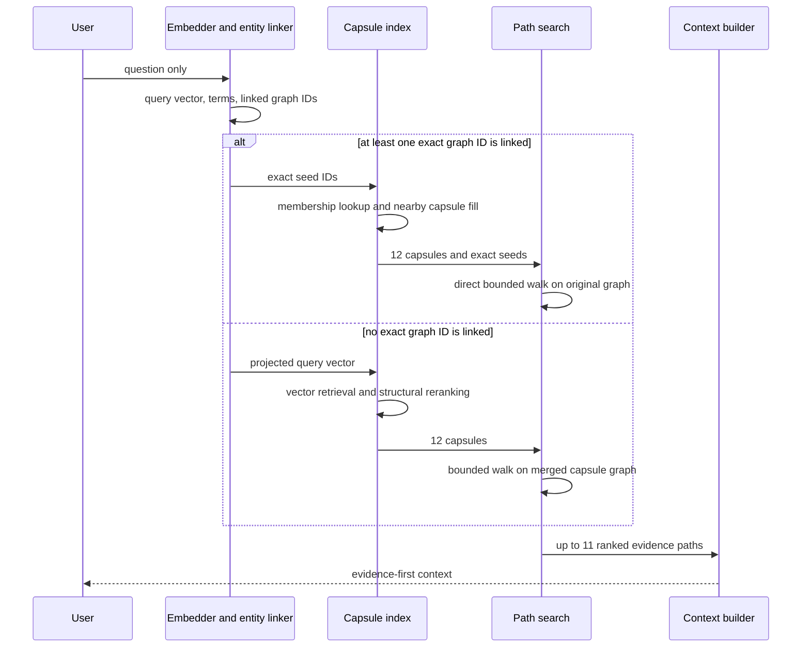

# 3. Runtime Retrieval Algorithm

## Input contract

```text
Input: question text and an operator-set maximum hop ceiling
Output: selected capsules, evidence paths, source snippets, context text
```

The runtime is never told the benchmark's gold hop count. In the evaluation
CLI, `--max-hops N` applies the same ceiling to normal graph expansion and
optimized path search.

## Adaptive query flow



## 1. Query representation and entity linking

The question receives a text embedding. Bracketed entities such as
`[The Matrix]` are extracted exactly; capitalized phrases are a fallback. IDs
are normalized so a linked entity can be checked against the indexed graph.

## 2. Exact-seed capsule routing

When linking finds a real graph node, the system does not score all 13,717
MetaQA capsules. It uses the offline node-to-capsule membership index:

1. reserve at least one seed-containing capsule for every linked seed;
2. add other seed-containing capsules;
3. fill the fixed 12-capsule budget through strongest supergraph neighbors;
4. if a component is disconnected, fill from the same partition region, then
   use a deterministic global fallback.

This preserves capsule/source coverage while reducing measured routing time to
about 0.10 ms per MetaQA query.

## 3. Learned routing fallback

If no exact seed is available, the trained residual projector reranks cached
semantic capsule vectors. R-GCN vectors remain a separate structural feature.
Normalized vectors live in one contiguous NumPy matrix, so cosine scoring is a
native matrix-vector multiplication.

First-stage score:

```text
0.65 * projected/capsule cosine
+ 0.30 * entity-token overlap
+ 0.05 * source coverage
```

The first 100 candidates are structurally reranked using text, entity,
query/capsule structural cosine, source coverage, and capsule-supergraph
proximity. The router returns 12 capsules. This fallback is important for
ambiguous or unlinked real-world questions; it is not paid for when exact
MetaQA entity linking already supplies a reliable launch node.

## 4. Direct bounded path search

For exact seeds, the path searcher walks the immutable original graph directly.
It does not copy selected capsules or materialize a 2,400-node neighborhood.
Capsules still decide which source chunks may enter context.

The searcher precomputes node and relation terms at index time. At query time it
ranks relation labels first, caps fan-out, rejects cycles/duplicate edge
signatures, and carries incremental scores through a small beam. Every linked
seed receives its own fair share of the 11-path budget.

For the fallback route, the searcher instead merges the selected capsule graphs
and applies the same bounded beam. This keeps retrieval functional even when
entity linking returns no exact ID.

## 5. Depth-balanced ranking

The 11 candidate slots are divided across all allowed depths before results are
globally ranked. A shallow path therefore cannot consume the whole budget before
depth-two or depth-three evidence is considered.

Path score:

```text
0.35 * node/query overlap
+ 0.50 * edge-relation/query overlap
+ 0.15 * depth coverage
```

This remains hop-agnostic: the operator supplies only a maximum depth, while the
question's relation words determine which paths rank highest.

## 6. Source snippet ranking

Within selected capsules, source chunks are scored instead of taking the first
three stored chunks:

```text
0.65 * lexical query/chunk cosine
+ 0.20 * capsule score
+ 0.15 * path-node participation
```

Results are deduplicated, capped per capsule, and globally capped.

## 7. Context ordering

The context is deliberately ordered:

1. ranked graph evidence paths;
2. query-ranked source evidence;
3. capsule overview metadata.

If the character budget is reached, overview metadata disappears before
answer-bearing evidence.
