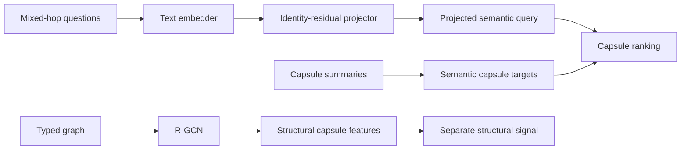

# 4. R-GCN and Unified Projector Training

## Why two learned components exist

A text embedding understands wording; a graph embedding understands structural
position and typed relations. They live in different vector spaces.



## R-GCN

The R-GCN learns one vector per graph node. Every layer combines a self-loop
transformation with relation-specific neighbor messages:

```text
h'_v = ReLU(W_self h_v + mean over incoming (h_u W_relation))
```

Forward and inverse message relations are used so evidence propagates in both
directions. Validation edges are removed from message passing to prevent
leakage. A DistMult decoder scores link triples:

```text
score(source, relation, target)
= sum(h_source * relation_diagonal * h_target)
```

Positive examples are real edges; negatives use corrupted targets. Training
uses binary cross entropy, AdamW, gradient clipping, early stopping, fixed
validation negatives, MRR, and Hits@1/3/10.

### GPU memory fix

The old expression indexed a 64x64 relation matrix for every edge, producing an
`[edge_count, 64, 64]` tensor that could exceed 6 GB. The current layer groups
edges by relation and processes message batches of 16,384, materializing only
`[batch, 64]` messages while preserving the same mathematics.

## Capsule pooling

After training, node embeddings belonging to each deterministic capsule are
mean-pooled and L2-normalized. The versioned v4 NPZ contains aligned:

- `capsule_ids`;
- `embeddings`;
- `search_texts`.
- capsule node/edge membership;
- graph edge endpoints for path-supervision mining.

The metadata stores graph settings, node/relation vocabularies, training
history, schema version, seed, manifest name, and capsule fingerprint.

## Unified MetaQA query projector

One projector is trained from 15,000 shuffled questions: 5,000 each from the
1-hop, 2-hop, and 3-hop training splits. No hop value is an input feature.

Each training example is:

```text
(question, up to 16 positive capsules, up to 20 hard-negative capsules)
```

MetaQA positives are path-launch capsules: each contains a first edge on a gold
path from the bracketed query entity to any correct answer. This matches the
router's real responsibility. A capsule containing only the final answer may be
several hops away and is not automatically a useful routing target. Hard
negatives share rare query terms but do not contain a valid first path edge.

The original design projected questions directly into the 64-dimensional R-GCN
link-reconstruction space. Held-out MRR was effectively random because that
space encodes topology, not question semantics. The corrected target is a cached
768-dimensional `nomic-embed-text` embedding of each capsule summary. R-GCN
vectors remain a separate structural feature.

The MLP is:

```text
normalize(text_vector + residual_MLP(text_vector))
```

The residual output layer starts at zero, so epoch 0 exactly equals raw semantic
retrieval. Early stopping selects by full-capsule any-positive MRR, preventing
training from erasing the useful base embedding alignment.

The multi-positive contrastive objective puts the probability mass of every
positive in one numerator:

```text
loss = logsumexp(positive logits + hard-negative logits)
       - logsumexp(positive logits)
```

A 0.05 negative margin and 0.10 temperature are used. Validation ranks the best
of any retained positive and reports any-positive MRR and Recall@1/5/10/20.
Capsule scoring is batched in groups of 2,048 for GPU safety. The independent
test evaluator does not cap positives, so it measures any valid gold capsule.

## Artifact layout and compatibility

```text
artifacts/rgcn/metaqa_shared_graph_train/
  capsule_rgcn.pt
  capsule_rgcn_embeddings_v4.npz
  capsule_rgcn_metadata.json

artifacts/rgcn/metaqa_unified_vanilla_train/
  capsule_semantic_embeddings_nomic_embed_text.npz
  query_projection_mlp.pt
  query_projection_metadata.json
```

The structural folder represents the shared MetaQA KB. `TrainedStructuralEncoder`
deliberately supports separate structural
and projector directories. Runtime enables learned routing only if both
fingerprints match the exact runtime capsules; otherwise it fails closed to the
fallback encoder.

## Train/test separation

- R-GCN: graph edges with train-only message passing for validation.
- Projector: MetaQA train questions only.
- Final reports: MetaQA test questions only.
- Hop labels: used to group reports, never supplied to projector or retrieval.
