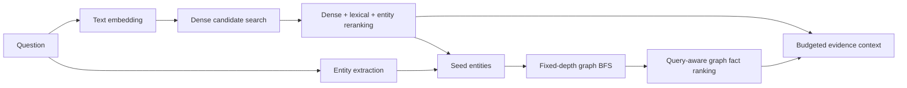
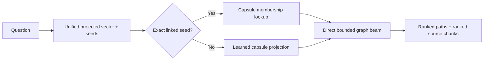

# 5. Normal GraphRAG vs Optimized GraphRAG

## Normal pipeline



The comparison baseline is now a production hybrid retriever, not the old
graph-only BFS timing stub. When a dataset supplies an authoritative graph, it
keeps that graph and separately embeds every source fact; it does not extract a
second noisy graph from those facts. Source vectors are normalized into a
persistent contiguous NumPy matrix. At query time it retrieves a wider dense
candidate set, reranks it with lexical/entity signals, combines exact and
evidence-derived seeds, performs the capped graph expansion, deduplicates and
ranks graph facts, balances depths, and builds context under a character budget.

## Optimized pipeline



## Comparison

| Dimension | Normal | Optimized |
|---|---|---|
| Retrieval unit | text chunk + raw neighborhood | structural capsule + evidence path |
| Whole-graph control | fixed BFS depth/limit | hierarchy, hub caps, region/capsule budgets |
| Learned structure | no | R-GCN plus query projection |
| Exact seed guarantee | incidental | explicit per-seed capsule/path reservation |
| Unknown reasoning depth | one configured BFS | balanced evidence across 1–3 depths |
| Source ordering | dense + lexical/entity rerank | query/path-aware snippet rank |
| Artifact validation | not applicable | fingerprint and >=95% ID match |
| Index cost | full source-vector build, persistent | capsule/model build, reusable |
| Query cost | dense retrieval + ranked BFS | membership/projection routing + direct bounded path search |
| Explainability | chunks and neighborhood | capsule IDs, seeds, typed paths, sources |

## Why the optimized system can be better

- It searches the complete MetaQA graph without embedding every triple.
- Hubs cannot dominate expansion without limits.
- Structurally relevant but lexically different evidence can be retrieved.
- Exact linked entities cannot be silently discarded by semantic ranking.
- Multi-step evidence is rendered as readable typed paths.
- Context contains fewer, more deliberate units.

## Why it is not universally better

- It has more moving parts and offline training.
- A bad entity linker still harms both systems.
- Projector labels are weakly mined rather than manually annotated capsule IDs.
- Search remains bounded; evidence beyond the maximum depth can be missed.
- On a tiny graph, normal BFS may be faster and sufficient.

The correct comparison is therefore measured quality, latency, compute, and
failure behavior—not the word “optimized” by itself.

## Fair hop-cap comparison

Use one explicit `--max-hops N` value for both systems. The CLI constructs fresh
runtime configs where:

```text
normal.graph_depth = N
optimized.max_path_length = N
optimized.seed_expansion_depth = N
```

The optimized offline `max_hops` field is the capsule construction radius and is
not changed: doing so would build different capsules and invalidate the R-GCN
fingerprint. Offline capsule radius and online traversal ceiling are separate
concepts despite their historically similar names.
