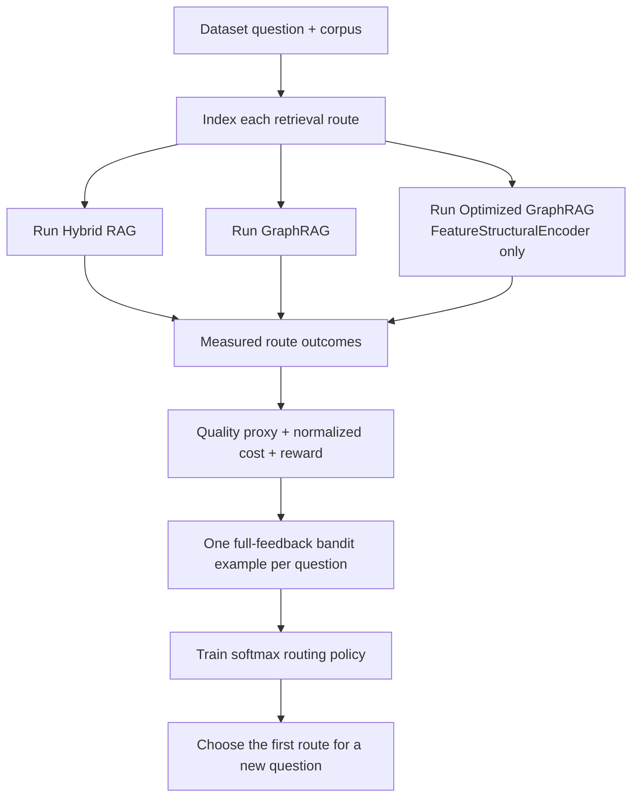

# RL Router Pipeline and Intuition

## What this part of the project solves

The three retrieval routes have different strengths and costs:

| Route | Strong when | Cost/risk |
|---|---|---|
| Hybrid RAG | The answer is stated in text and shares words or meaning with the question. | Usually avoids graph work, but can miss multi-hop relations. |
| GraphRAG | The answer needs entities and typed graph relations. | Dense retrieval plus graph expansion can return a large context. |
| Optimized GraphRAG | The answer needs graph reasoning but a bounded local search is enough. | Capsule building and path search are more complex; bounded search can miss evidence. |

Always using the strongest route is wasteful. Always using the cheapest route is
unsafe. The router learns the trade-off from measurements: for a question like
“Who directed [Film]?” Hybrid RAG may be enough; for “Which languages are used
by films sharing a director with [Film]?”, a graph route is more likely to be
needed.

The router is **not another answer model**. It is a policy that selects one of
the existing retrievers before the answer-generation step.

## R-GCN-free experiment boundary

This workflow deliberately turns off the trained structural artifacts:

- no `CapsuleRGCN` inference;
- no exported R-GCN capsule embeddings;
- no query-projection MLP;
- no `TrainedStructuralEncoder`.

Optimized GraphRAG still works. It uses `FeatureStructuralEncoder`, which is a
small deterministic summary of capsule size, edge density, hub proportion,
overlap, relation diversity, and source coverage. Its first-stage capsule
retrieval remains ordinary semantic text retrieval using `nomic-embed-text`.

This isolation is useful for a final-year experiment because it asks a clean
question: *can cost-aware routing improve the three retrieval systems without
claiming that an R-GCN caused the improvement?*

The text embedding model is not disabled. All dense/hybrid/semantic-capsule
retrieval needs an embedding model. The optional answer-generation model is
also still needed when `--run-generation` is selected.

## End-to-end data flow



There are two phases.

### 1. Offline outcome collection

For each training question, `build_route_outcomes.py` runs **all three routes**.
That gives the project the quality and cost of every possible action for that
same question. This is called a counterfactual outcome table.

For example:

| Question | Route | Quality | Cost | Reward |
|---|---|---:|---:|---:|
| “Who directed [Film]?” | Hybrid | 0.90 | 0.12 | high |
| same question | GraphRAG | 0.92 | 0.78 | lower than Hybrid |
| same question | Optimized GraphRAG | 0.92 | 0.38 | medium |

The training target is therefore not “GraphRAG is correct.” It is “Hybrid is
the cheapest route that still meets the quality gate for this question.”

### 2. Online route selection

For a new question, the trained policy receives cheap question features and
chooses one route. In this initial implementation it chooses **one first
route**. It does not yet execute an accept/escalate loop.

## The route implementations

### Hybrid RAG

Hybrid RAG calls both a lexical BM25 retriever and a dense vector retriever.
Reciprocal-rank fusion combines their lists. This exists because exact entity
names help BM25, while paraphrases help dense embeddings.

Code: `src/rag/hybrid/pipeline.py`.

### GraphRAG

GraphRAG retrieves a dense candidate set, extracts/link entities, expands a
fixed-depth graph neighborhood, ranks graph facts, then builds a combined
text-and-graph context. For MetaQA it uses the authoritative native triples.

Code: `src/g_rag/pipeline.py`.

### Optimized GraphRAG

Optimized GraphRAG builds overlapping bounded graph capsules. For an exact
linked entity it directly looks up seed-containing capsules, then performs
bounded relation-aware path search. When no seed can be linked, it semantically
selects capsules and searches their merged local graph.

Code: `src/optimized_grag/pipeline.py`.

## Why a router needs all three routes measured first

If a training question is only sent to the selected route, the reward of the
other routes is unknown. Training then confuses “not tried” with “bad.” By
running every route offline, the bandit has full feedback: it knows that Hybrid
was cheap, GraphRAG was expensive, and Optimized GraphRAG may have had the best
quality/cost balance. This makes the first RL stage reproducible and much safer
than trying to learn directly from sparse production feedback.

## What comes after this initial router

The proposal's second RL stage is sequential control:

```text
choose a route → inspect evidence/critic score → accept or escalate or abstain
```

It should be added only after the first-route bandit is validated. A deployed
critic must estimate adequacy from the answer and evidence; it cannot use gold
answers, because gold answers are only available in offline benchmark data.
