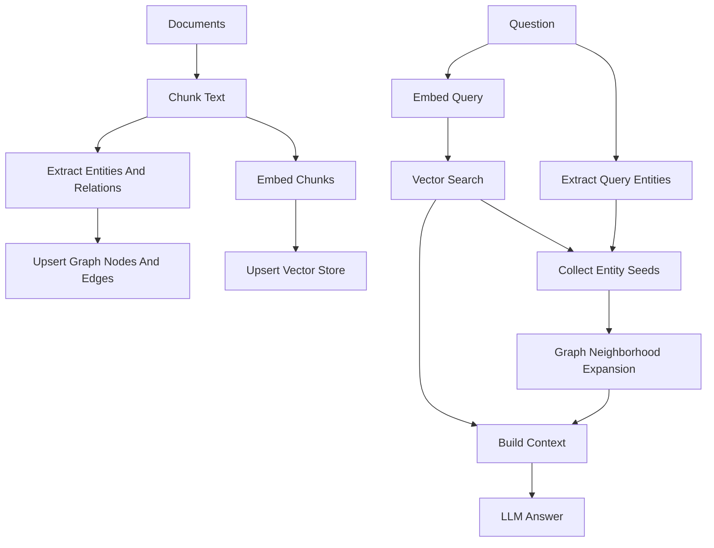

# GraphRAG

GraphRAG extends normal vector RAG by adding an explicit knowledge graph retrieval step. Normal RAG retrieves chunks that are semantically similar to the question. GraphRAG also extracts entities and relations from those chunks, stores them as graph nodes and edges, and uses graph expansion to recover multi-hop evidence that may be split across different text chunks.

This is useful for questions where the answer depends on a chain of facts rather than one directly matching passage.

## Why It Is A Good Idea

Vector retrieval is good at "find text like this question". It is weaker when the query requires following relationships:

```text
Question
  -> entity A
  -> relation to entity B
  -> relation to entity C
  -> final answer
```

GraphRAG makes those relationships first-class data. Instead of hoping the vector store retrieves every supporting paragraph, it can start from retrieved entities and walk nearby graph structure.

For your project, this is the key reason GraphRAG can outperform normal RAG on multi-hop datasets such as MetaQA, 2WikiMultiHopQA, and MultiHop-RAG.

## Current Pipeline



## Main Files

`pipeline.py`

The main `GraphRAG` class. It owns indexing, retrieval, and answer generation. It connects the graph store, vector store, embedding adapter, LLM adapter, extractor, chunker, and compute tracker.

`extractors.py`

Entity and relation extraction. The simple extractor is dependency-free and useful for smoke tests. The LLM extractor asks an LLM to return entities and relations as JSON for stronger graph construction.

`context.py`

Builds the final prompt context from vector evidence and graph evidence.

`types.py`

GraphRAG-specific dataclasses: configuration, indexing report, retrieved context, and answer shape.

`chunking.py`

Compatibility export for the shared `TextChunker` in `src/helpers/chunking.py`.

`instrumentation.py`

Compatibility export for the shared compute tracker in `src/compute_eval`.

## How Indexing Works

During indexing, GraphRAG:

1. Normalizes input documents.
2. Splits documents into reusable chunks.
3. Extracts entities and relations from each chunk.
4. Writes entities and relations into the graph store.
5. Embeds chunks and writes them into the vector store.
6. Stores graph entity ids in chunk metadata so vector retrieval can seed graph expansion later.

## How Querying Works

At query time, GraphRAG:

1. Embeds the question.
2. Retrieves top vector chunks.
3. Extracts entities from the question.
4. Combines query entities with entities found in retrieved chunks.
5. Expands a bounded graph neighborhood around those seed entities.
6. Sends both vector evidence and graph evidence to the LLM.

## Why It Can Beat Normal RAG

Normal RAG can miss answers when evidence is distributed across multiple chunks. GraphRAG can recover those chains because the graph stores relationships independently from chunk boundaries.

Example:

```text
Chunk 1: Apple competes with Huawei.
Chunk 2: Huawei gained market share in China.
Chunk 3: Apple sales declined in China.
```

A vector search may retrieve only one or two of these chunks. GraphRAG can connect the entities and relations:

```text
Apple -> competes_with -> Huawei -> gained_market_share_in -> China
Apple -> sales_declined_in -> China
```

That structure gives the LLM cleaner multi-hop evidence.

## Limits

This baseline GraphRAG still performs neighborhood expansion around seeds. If the graph has high-degree hubs, expansion can become expensive. That is why `optimized_grag` introduces bounded graph capsules and capsule routing.

For graph-native datasets, `index_dataset_bundle(..., include_documents=False)`
seeds the complete native graph without embedding redundant one-line triple
documents. This is the recommended MetaQA baseline.
