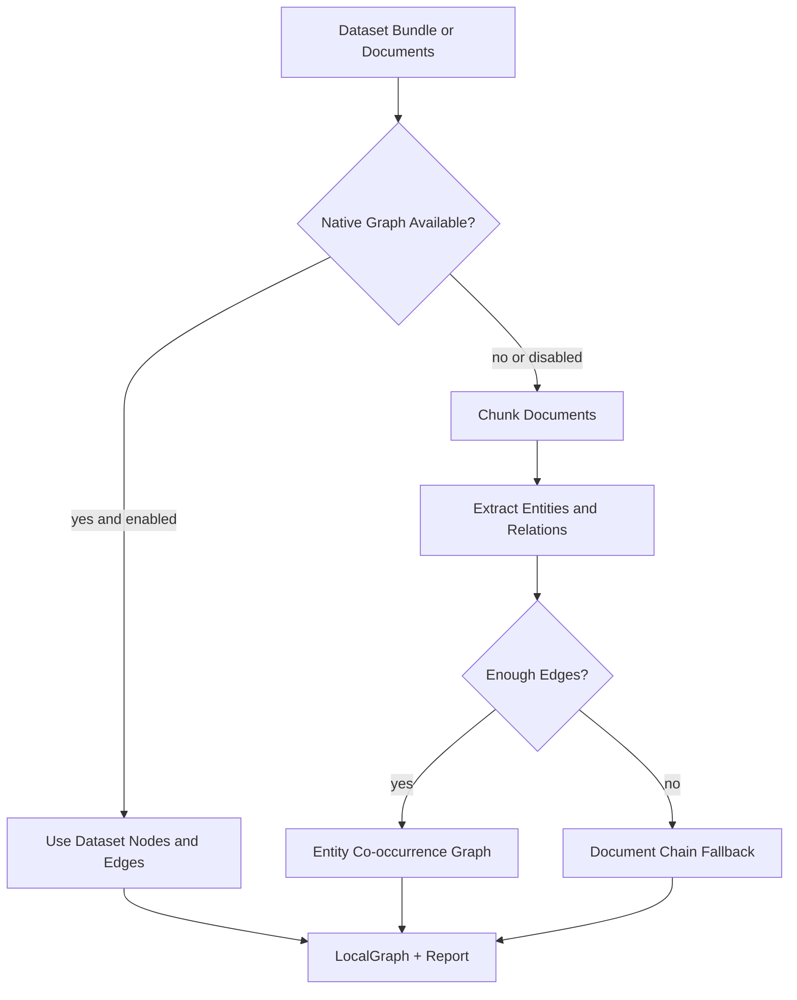

# Graph Construction

This folder owns the reusable path from raw dataset/documents to the local graph used by optimized GraphRAG.

It exists because MetaQA already has clean graph triples, while datasets like 2WikiMultiHopQA and MultiHop-RAG mostly provide text, questions, answers, and evidence. Training and indexing should not each invent their own graph-building logic.

## Files

- `types.py` defines construction config, per-chunk graph output, and reports.
- `fallbacks.py` contains deterministic fallback graph builders.
- `builder.py` contains `DocumentGraphConstructor` and notebook-friendly helpers.
- `__init__.py` exports the public construction API.

## Construction Flow



## Public API

```python
from src.optimized_grag.graph_construction import build_training_graph

graph, report = build_training_graph(
    bundle,
    {
        "graph_from_documents": True,
        "chunk_size": 850,
        "chunk_overlap": 100,
    },
)
```

For lower-level access:

```python
from src.optimized_grag.graph_construction import (
    DocumentGraphConstructor,
    GraphConstructionConfig,
)

constructor = DocumentGraphConstructor(
    config=GraphConstructionConfig(chunk_size=900, chunk_overlap=120),
)
result = constructor.from_documents(documents, dataset_name="my-corpus")
```

`result` includes:

- `graph`: the `LocalGraph`
- `chunks`: document chunks
- `chunk_graphs`: extracted nodes/edges per chunk
- `nodes` and `edges`: final graph nodes/edges
- `report`: source, counts, and fallback details

## Current Limitation

The default extractor is intentionally lightweight. It is useful for smoke tests and bootstrapping, but serious real-world graphs should replace it with a stronger extractor: entity linking, relation extraction, citation/table parsing, and possibly LLM-backed extraction.
