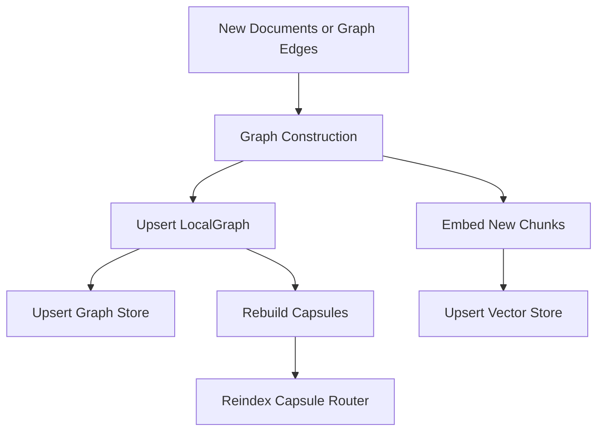

# Graph Updates

This folder owns reusable graph update logic for optimized GraphRAG.

The goal is to keep ingestion/update behavior separate from retrieval and model training. New files, corrected triples, or extracted relations should flow through one update API instead of each caller manually mutating the graph.

## Files

- `types.py` defines update config and update reports.
- `updater.py` contains `GraphUpdateManager`.
- `__init__.py` exports the public update API.

## Update Flow



## Public API

```python
from src.optimized_grag.graph_updates import GraphUpdateManager

updater = GraphUpdateManager(
    local_graph=local_graph,
    graph_store=graph_store,
    vector_store=vector_store,
    embedding_adapter=embedding_adapter,
    capsule_pipeline=capsule_pipeline,
    capsule_index=capsule_index,
)

report = updater.apply_documents(new_documents, dataset_name="new-upload")
```

For explicit graph changes:

```python
report = updater.apply_graph(nodes=[node], edges=[edge])
```

## Current Rebuild Strategy

The first implementation rebuilds capsules over the full local graph after each update. That is correct and simple, but it is not the final scaling strategy.

The report already tracks:

- affected node ids
- affected edge ids
- update counts
- capsule rebuild scope

That gives us the hook for the next version:

```text
affected nodes
 -> impacted regions
 -> rebuild only impacted capsules
 -> atomically swap updated capsule index
```

For model retraining, use the same principle:

1. Apply graph updates immediately.
2. Rebuild/reindex capsules so retrieval sees new evidence.
3. Train or fine-tune structural models in the background.
4. Write artifacts into a new versioned folder.
5. Evaluate before promotion.
6. Atomically switch the active model/index only if the new version is better.
