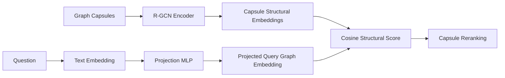

# Optimized GraphRAG Models

The model layer gives optimized GraphRAG structural awareness. Text embeddings tell us what a capsule is about. Graph embeddings tell us how a capsule is organized. Query projection connects the user's text question to the graph embedding space.

The runtime code is intentionally lightweight. If trained models are not available, optimized GraphRAG uses a feature-based structural fallback from `structural.py`. The notebooks train stronger versions that can be exported later.

## Runtime Model Interface

`structural.py` defines the seam used by retrieval:

```python
class StructuralEncoder:
    def encode_capsule(self, capsule) -> list[float]:
        ...

    def project_query(self, query_vector) -> list[float]:
        ...
```

Any trained model adapter only needs to satisfy this interface.

Trained vectors and projectors are enabled only when all three identities agree:

- runtime capsule fingerprint
- exported R-GCN capsule fingerprint
- exported projector capsule fingerprint

The runtime also requires at least 95% capsule-ID match. Otherwise it fails
closed to the feature structural encoder instead of mixing incompatible spaces.

## Current Runtime Fallback

`FeatureStructuralEncoder` encodes a capsule from cheap graph statistics:

- node count
- edge count
- density
- connected component ratio
- hub ratio
- overlap ratio
- relation type count
- source document count

This gives the router a structural signal even before R-GCN training is complete.

`FoldedQueryProjector` folds the query embedding into the same small vector dimension. It is not meant to be final research quality; it is a practical placeholder so the whole optimized pipeline can run end to end.

## Intended Trained Model Flow



## R-GCN Capsule Embeddings

R-GCN stands for Relational Graph Convolutional Network. It is useful here because knowledge graphs have typed edges:

```text
Apple -> competes_with -> Huawei
Apple -> sells -> iPhone
Apple -> located_in -> USA
```

A normal graph encoder may treat all edges similarly. R-GCN learns separate transformations for different relation types, so relation structure affects the embedding.

In this project, R-GCN is used offline:

1. Build graph capsules.
2. Train a small R-GCN on graph link prediction.
3. Pool node embeddings inside each capsule.
4. Export capsule-level structural embeddings.
5. Use those stored embeddings for fast query-time reranking.

## Query-To-Graph Projection

The user's query starts in text embedding space, but R-GCN capsule embeddings live in graph-structure space. Query-to-graph projection learns a bridge:

```text
query text embedding -> Projection MLP -> query graph embedding
```

The projection is trained with evidence-aware weak supervision:

```text
query + positive capsule + negative capsule
```

The goal is to make the projected query closer to capsules containing annotated
supporting titles/facts or answer endpoints and farther from lexically confusing
hard negatives. Validation reports full-capsule Recall@1/5/10 and MRR.

## Notebook Layout

Training notebooks live under `src/optimized_grag/notebooks`:

```text
notebooks/
  rgcn/
    01_train_capsule_rgcn.ipynb
    README.md
  projection/
    01_train_query_projection.ipynb
    README.md
```

The notebooks are separated because R-GCN and query projection are different training problems:

- R-GCN learns graph/capsule structural embeddings.
- Projection learns how text questions map into that structural space.

## Why This Is Cool

This avoids running a graph neural network over the full graph for every query. Instead:

```text
Offline:
  train/refresh structural capsule embeddings

Query time:
  compare projected query vector with stored capsule vectors
```

That keeps the optimized GraphRAG query path cheap while still giving it relation-aware graph structure.
