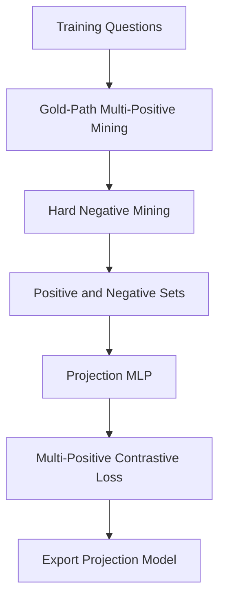

# Query-To-Graph Projection Notebook

Notebook:

`01_train_query_projection.ipynb`

This notebook trains an identity-residual MLP that maps text query vectors into
a semantic capsule target space while retaining R-GCN vectors as a separate
structural signal. MetaQA
trains one unified projector from a shuffled mixture of 1/2/3-hop training
questions. The same projector handles every runtime query; hop labels are used
only to report held-out benchmark slices.

The notebook defines all dataset configurations without activating them. Set
`PROJECTION_DATASET = "metaqa"`, `"2wiki"`, or `"multihop_rag"` in the single
selection cell. `Run All` is safe: later definition cells do not overwrite the
selected dataset.

It does not rebuild capsules. The R-GCN export stores `search_texts` aligned with
the exact capsule IDs and embeddings in the versioned NPZ declared by
`projection_manifest`. Projection
training consumes that manifest directly, eliminating duplicate graph work and
making capsule-fingerprint drift impossible between the two notebooks.

By default, query vectors are produced with Ollama:

```text
nomic-embed-text
```

Set `USE_OLLAMA_QUERY_EMBEDDINGS = False` in the notebook only if you want the lightweight hashing fallback for quick offline debugging.

## Why It Exists

Text embeddings and graph embeddings are not the same kind of signal.

```text
Text embedding:
  semantic similarity between words and passages

Graph embedding:
  relation-aware structure inside capsules
```

The projection model learns:

```text
questions should rank capsules that contain the first edge
of a valid answer path above semantically similar distractors
```

## Training Flow



## Weak Labels

The notebook builds multi-positive examples:

```text
query, positive_capsules[up to 16], hard_negatives[up to 20]
```

Positive capsules contain a first edge on a valid path from the bracketed MetaQA
seed entity to any gold answer. This is the launch point the router controls;
requiring the selected capsule to contain the final multi-hop answer was a
misaligned target. Query-similar capsules without a gold first edge become hard
negatives. The log-sum-exp objective rewards all valid launch capsules.

Run `scripts/build_capsule_semantic_artifact.py` before the notebook. The
projector starts as an exact identity over these semantic vectors, then learns a
small residual. R-GCN link-reconstruction embeddings are not used as the text
target because held-out experiments showed that space was effectively random
for question-to-capsule ranking.

## Training Details

The notebook includes:

- train/validation split
- multi-positive log-sum-exp contrastive loss
- AdamW
- dropout
- gradient clipping
- early stopping
- any-positive validation MRR and full-capsule Recall@1/5/10/20
- memory-bounded validation ranking (2,048 capsules per score batch)
- R-GCN/projector capsule fingerprint validation
- direct use of the R-GCN projection manifest (no capsule rebuild)
- export metadata

After export, use `scripts/evaluate_query_projection.py` for uncapped
any-positive evaluation on held-out test questions. It also reports the matching
random-ranker baseline and caches results by a full artifact/code fingerprint.

## Output

The notebook reads the dataset-specific R-GCN artifacts and exports projection artifacts into the same folder:

```text
artifacts/rgcn/<dataset-artifact-name>/
  capsule_rgcn.pt
  capsule_rgcn_embeddings_v4.npz
  capsule_semantic_embeddings_nomic_embed_text.npz
  query_projection_mlp.pt
  query_projection_metadata.json
```

For all three datasets, train the R-GCN notebook once per dataset first, then run this notebook once per matching dataset block. These projection artifacts can later be loaded by a trained model adapter that implements `StructuralEncoder.project_query`.
