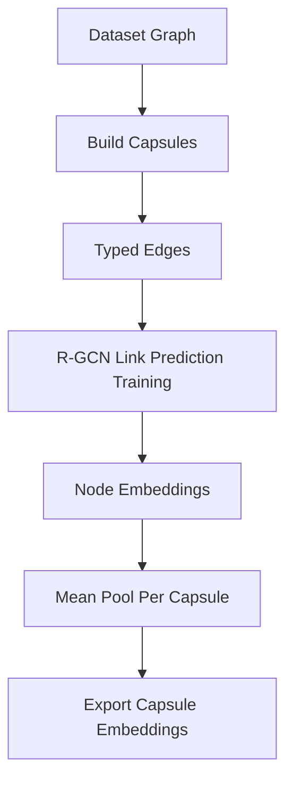

# R-GCN Capsule Embedding Notebook

Notebook:

`01_train_capsule_rgcn.ipynb`

This notebook trains a lightweight R-GCN for capsule structural embeddings.
It supports separate runs for:

- MetaQA shared graph (one R-GCN for 1/2/3-hop)
- 2WikiMultiHopQA
- MultiHop-RAG

Run exactly one dataset selection cell, then run the remaining cells. To get all three models, rerun the notebook once per dataset block.

Graph construction is shared with runtime code through:

```python
from src.optimized_grag.graph_construction import build_training_graph
```

So if you later improve extraction, fallback graphs, or dataset graph handling, the notebook gets that behavior from the reusable construction package instead of duplicating it.

The R-GCN itself is structural: it learns from graph edges, not from text embeddings. The downstream projection notebook uses Ollama `nomic-embed-text`, and generation/evaluation notebooks use `qwen3:4b-instruct` when LLM output is enabled.

Relation messages are grouped by relation and processed in bounded batches. This
avoids the former `[edge_count, hidden_dim, hidden_dim]` allocation (about 6.4 GB
at common graph sizes). The notebook exposes `MESSAGE_BATCH_SIZE`; 16,384 is the
default and can be lowered without changing model semantics.

## What It Learns

It learns node embeddings from typed graph relations, then pools node embeddings into one vector per graph capsule.



## Training Objective

The notebook uses relation-aware link prediction:

- positive examples are real graph edges
- negative examples are corrupted target nodes
- validation edges are excluded from message passing
- inverse relation messages propagate evidence in both graph directions
- a DistMult relation-aware decoder scores triples
- fixed filtered validation negatives make epochs comparable
- loss is binary cross entropy over positive and negative triples

It includes:

- train/validation split
- dropout
- AdamW
- gradient clipping
- early stopping
- validation MRR and Hits@1/3/10
- compressed embedding export
- a deterministic capsule fingerprint required by runtime

## Output

The notebook exports artifacts under dataset-specific folders:

```text
artifacts/rgcn/<dataset-artifact-name>/
  capsule_rgcn.pt                 # trained R-GCN weights
  capsule_rgcn_embeddings_v4.npz  # pooled vectors + search text + capsule/edge supervision manifest
  capsule_rgcn_metadata.json      # dataset, graph, capsule, and training metadata
```

Example artifact names:

```text
artifacts/rgcn/metaqa_shared_graph_train/
artifacts/rgcn/2wiki_train_sample/
artifacts/rgcn/multihop_rag_train_sample/
```

These artifacts can later be wrapped by a trained `StructuralEncoder` implementation.

Its R-GCN is trained only from the shared MetaQA KB. The unified projector reuses
this structural directory rather than retraining identical graph weights.

The versioned NPZ also contains `search_texts`, a projection-training manifest aligned
one-to-one with `capsule_ids` and `embeddings`. Do not remove it: the projection
notebook deliberately consumes this exact manifest instead of rebuilding capsules.
