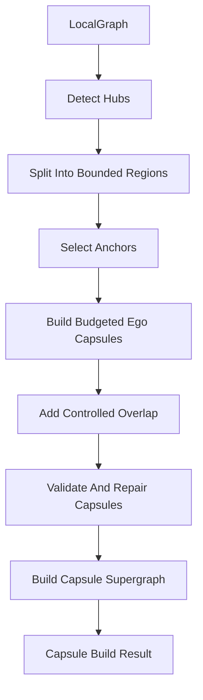

# Optimized GraphRAG Partitioning

Partitioning is the offline graph-preparation stage for optimized GraphRAG. Its job is to turn a potentially large knowledge graph into small, bounded, overlapping graph capsules that can be retrieved cheaply at query time.

The core idea is simple:

```text
Do expensive graph organization offline.
Do only small bounded graph search online.
```

## Why Partitioning Exists

Plain GraphRAG expands from seed entities at query time. That is useful, but it can explode if a seed is connected to a hub node such as `China`, `market`, `Apple`, or `United States`.

Optimized GraphRAG avoids this by prebuilding graph capsules:

```text
Full graph
  -> bounded regions
  -> anchor-centered capsules
  -> capsule supergraph
  -> query-time capsule retrieval
```

At query time, we open only a few capsules instead of walking the whole graph.

Capsule construction now has a hard completeness invariant: every graph node
must occur in at least one capsule. After normal anchor capsules are built, the
pipeline creates bounded fallback ego capsules only for uncovered nodes. The
index report exposes `node_coverage_rate`, `uncovered_node_count`, and
`coverage_capsule_count`, and construction fails if coverage is incomplete.

## Offline Flow



## Main Files

`pipeline.py`

Orchestrates the full offline partitioning flow. It calls hub detection, region partitioning, anchor selection, capsule building, validation, and supergraph creation.

`types.py`

Defines the core objects:

- `Region`: a bounded set of graph node ids.
- `GraphCapsule`: a small graph slice with nodes, edges, stats, relation types, boundary nodes, and summary text.
- `CapsuleStats`: size, density, hub ratio, overlap ratio, connectedness.
- `CapsuleCandidate`: a scored capsule used during retrieval.

`hubs.py`

Detects high-degree nodes using degree percentile. Hubs are not deleted, but expansion through them is throttled.

`regions.py`

Splits the graph into bounded regions. The current implementation is dependency-free and approximates community splitting with label propagation plus a balanced fallback. It is intentionally replaceable later with Leiden or METIS.

`anchors.py`

Selects important nodes inside each region. Anchors are the starting points for capsule construction.

`capsule_builder.py`

Builds capsules using budgeted k-hop expansion. It expands from an anchor, respects max node and edge budgets, limits hub expansion, and adds a small amount of boundary overlap.

`validation.py`

Repairs capsules so they stay useful and cheap. It enforces size, edge count, connectivity, hub ratio, and overlap ratio constraints.

`supergraph.py`

Builds a capsule-level graph. Two capsules are connected if they share important nodes or sources. Retrieval can use this for capsule proximity.
It uses inverted node/source membership indexes rather than comparing every
capsule pair, preserving overlap scores without quadratic full scans.

## Capsule Design

A good capsule should be:

- small enough for local path search
- connected enough to support reasoning
- not dominated by hubs
- allowed to overlap with related capsules
- rich enough to preserve useful paths

The point is not to partition the graph perfectly. The point is to create small answer-useful regions with controlled overlap.

## Query-Time Benefit

Without partitioning:

```text
Question -> seed entities -> expand full graph -> many paths -> expensive ranking
```

With partitioning:

```text
Question -> retrieve 8-12 capsules -> merge small capsule set -> bounded path search
```

This gives a real cost-control mechanism rather than just renaming a large subgraph as a "subgraph".

## Future Improvements

The current partitioner is intentionally lightweight. Later improvements can plug into `regions.py` and `pipeline.py` without changing query-time code:

- real Leiden community detection
- METIS balanced cuts
- PageRank-based anchors
- relation-aware expansion scores
- evidence-aware overlap from gold supporting facts
- adaptive capsule sizing by query complexity
